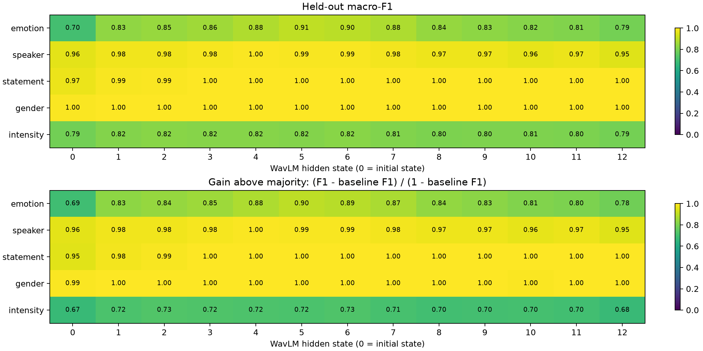
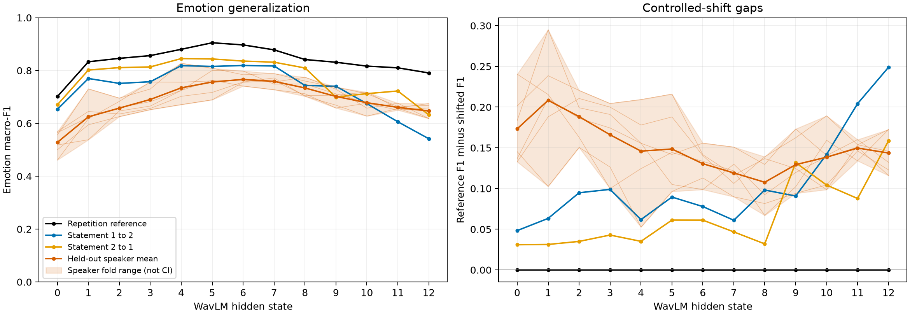

# M3: WavLM / RAVDESS

**M3A and M3B complete. Gate: PARTIAL / REVIEW NEEDED.**
No M4 work was started, and the paper repository was not changed.

## Run provenance and artifacts

- Experiment: `m3-wavlm-ravdess-20260930`.
- Code commit: `8a9e18fed6095b73ad7c29c9a0889c5a8a38802b`.
- Branch: `research2027/m3-wavlm-ravdess`.
- Cache: `d99979b610d68bef`, reused without encoder inference or audio access.
- Python 3.11.9; NumPy 2.4.6; SciPy 1.17.1; scikit-learn 1.9.1;
  matplotlib 3.11.2; PyArrow 25.0.1; threadpoolctl 3.7.0.
- Seed `20260930`; CPU execution, one numerical thread per fit; about 319 seconds.
- [Complete provenance and input hashes](results/m3-wavlm-ravdess-20260930/provenance.json).
- [Generated per-layer report, baselines and full speaker-fold distributions](results/m3-wavlm-ravdess-20260930/summary.md).
- [Machine-readable summary and gate](results/m3-wavlm-ravdess-20260930/summary.json).

The run contains 65 audit rows, 117 generalization rows, 507 C-candidate rows
covering 169 distinct final model fits, and 93,600 held-out prediction records.
The repetition reference deliberately repeats the emotion-audit predictions
under its own split/task name; it is not an additional independent fit.

## M3A: what is encoded?

Descriptive best layers by held-out macro-F1:

| Attribute | Best layer | Macro-F1 | Accuracy | Majority macro-F1 |
|---|---|---|---|---|
| Emotion | 5 | 0.9051 | 0.9083 | 0.0294 |
| Speaker | 4 | 0.9958 | 0.9958 | 0.0033 |
| Statement | 3 (first tied maximum) | 1.0000 | 1.0000 | 0.3333 |
| Gender | 1 (first tied maximum) | 1.0000 | 1.0000 | 0.3333 |
| Intensity | 2 | 0.8241 | 0.8250 | 0.3478 |

Emotion and both primary confounders are strongly linearly decodable on the
designated repetition audit. This is encoding evidence, not evidence of use.
Every layer, including weak layers, is retained in
[probes.csv](results/m3-wavlm-ravdess-20260930/probes.csv).



## M3B: where does emotion generalization fail?

At layer 5, the descriptive best repetition-reference layer:

| Evaluation | Macro-F1 | Accuracy | Macro-F1 gap from reference |
|---|---|---|---|
| Repetition 1 to 2 | 0.9051 | 0.9083 | 0.0000 |
| Statement 1 to 2 | 0.8156 | 0.8264 | +0.0895 |
| Statement 2 to 1 | 0.8439 | 0.8556 | +0.0612 |
| Held-out speakers, six-fold mean | 0.7566 | 0.7639 | +0.1485 |

Layer-5 speaker-fold macro-F1 ranges from 0.6891 to 0.8088; sample fold
standard deviation is 0.0464, not a confidence interval. Both lexical
directions and the speaker-fold mean underperform their same-layer repetition
reference at every layer. Speaker mean macro-F1 peaks at layer 6 (0.7666),
not at the final layer. At layer 12, the lexical gaps are +0.2489 and +0.1586.

The full [generalization table](results/m3-wavlm-ravdess-20260930/generalization.csv)
retains all six speaker folds and both lexical directions.



## Gate and remaining review

**PARTIAL / REVIEW NEEDED.** The descriptive screens are supported: emotion
and primary confounders are decodable, corresponding shift gaps are present,
and manifest/split/ID sanity checks pass. However, the plan did not specify
numerical meaningful-effect or significance thresholds. The pre-run protocol
therefore reserved the scientific gate for human review rather than inventing
thresholds after seeing results.

No M3 outputs are missing, and there are no known engineering blockers.
Human review and explicit M4 approval remain outstanding. M3 does not establish
classifier reliance, harmful use, or the benefit of erasure/retraining.
Do not synchronize new paper claims or start interventions automatically.

## Validation

- All 34 M0-M3 tests, CLI smoke checks and `pip check` passed.
- Real-input validation passed before fitting.
- [Saved-prediction verification](results/m3-wavlm-ravdess-20260930/verification.json)
  checks every metric row against persisted held-out IDs and manifest labels:
  maximum metric-recomputation error is zero.
- An independent confusion-matrix calculation reproduced all 182 metric rows
  to floating-point precision; C choices also match the saved training-CV scores.
- Every original input hash and generated artifact hash was rechecked.
  [Output checksums](results/m3-wavlm-ravdess-20260930/output_sha256.json)
  cover the scientific payload; Git attributes preserve its exact bytes.

## Predeclared protocol

- Use only cache `d99979b610d68bef`: 1,440 utterances, 13 hidden states,
  768 dimensions, float16 storage converted to float64 for the linear fits.
- Reuse the original manifest and persisted M1 splits. Require their validated
  identity, report consistency, ID ordering, complete coverage and no leakage.
  Do not relocate paths inside the manifest, regenerate splits or read audio.
- M3A: emotion, speaker, statement, gender and intensity probes on
  repetition 1 to repetition 2, for every layer.
- M3B: the identical repetition-reference emotion fit, both lexical
  directions and all six persisted speaker folds, for every layer.
- StandardScaler plus L2 logistic regression with the LBFGS solver.
  Use the same `C = [0.01, 0.1, 1]` grid throughout; seed `20260930`,
  maximum 2,000 iterations and tolerance `1e-4`.
- Select C by three-fold training-only macro-F1, with speaker-grouped inner
  folds for speaker-shift runs and stratified inner folds otherwise.
  Fit the scaler separately within each inner fold; refit on outer training
  data only. Exact ties prefer smaller C. Test outcomes never select C.
- Report macro-F1 over the full label space, accuracy, training-majority
  macro-F1/accuracy and uniform-chance accuracy. Chance accuracy is not
  presented as expected macro-F1.
- Save every held-out prediction, probability vector and class order, along
  with all C candidates and inner-fold scores. Recompute all published scores
  from saved predictions and check their IDs against persisted test partitions.
- Define gaps as repetition-reference performance minus shifted performance.
  Keep both lexical directions and all speaker folds; do not hide negative gaps.

The handoff did not specify a CV selection rule. Three-fold training-only
selection was chosen before the run; no test-guided protocol changes are allowed.
The paper plan also provides no numerical definition of a "meaningful" effect.
The automated gate therefore reports descriptive evidence for human review,
not an invented significance/effect-size threshold or permission to start M4.

## Commands

Run from `research2027` using the project environment:

```powershell
.\scripts\setup.ps1
.\scripts\smoke_test.ps1
.\scripts\stage1_probe.ps1 -ValidateOnly
.\scripts\stage1_probe.ps1 -OutputDir "results\m3-wavlm-ravdess-20260930"
```

These are the completed run's commands. A replay requires committed
code/configuration and a different, new output directory.
The [configuration](configs/experiments/m3_wavlm_ravdess.json) pins the cache
fingerprint and SHA-256 of the transferred split artifact. Raw audio, cached
embeddings and machine-local paths must not enter Git.

## Interpretation limits

M3 measures encoding and baseline emotion generalization, not reliance or
harmful use. Speaker-shift training uses 1,200 utterances versus 720 in the
reference/lexical splits; the requested gaps are not matched-size causal
estimates. Neutral occurs only at normal intensity. Fold variation is not a
confidence interval, and descriptive best layers are not unbiased estimates
of a layer-selection procedure.
