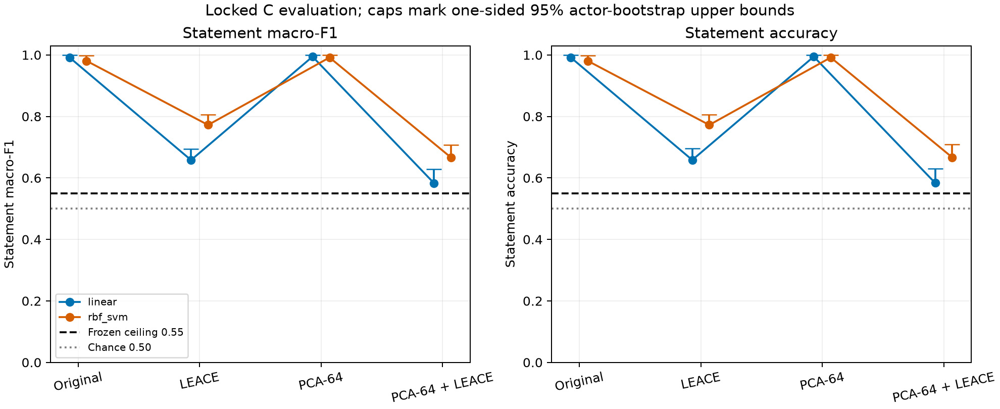
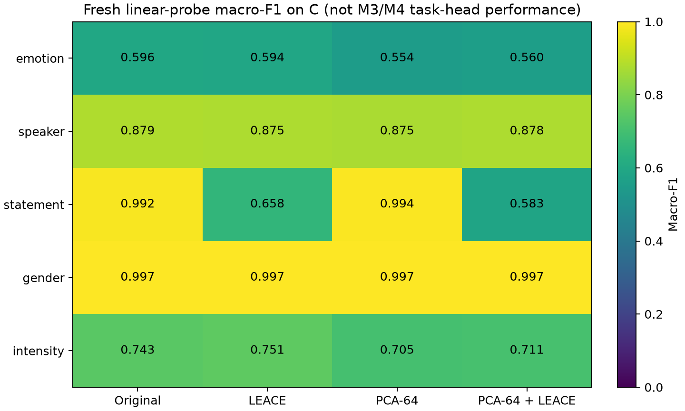

# M4-V1: bounded erasure-validity result

**Decision: FAIL_RESIDUAL_DECODABILITY**

Run `m4-validity-v1-wavlm-ravdess-20260930`; code `db0a29638d9e7b2def50a9acd5b5431e29c82540`; protocol `d9fdf6575da150d0c8ce0a0ebe7070a5207137d4`.

Layer 5, existing WavLM/RAVDESS cache, 64 PCA components, seed 20260930. A/B/C contain 720/360/360 utterances in disjoint matched cells. All 24 probe models were fitted/tuned on B and frozen before C scoring. Scaler, PCA and both erasers were fitted on A only.

## Statement information on locked C

U95 is a one-sided 95% speaker-cluster percentile upper bound, conditional on these fitted probes and this previously explored corpus. It is not a universal information-absence certificate.

| Arm | Probe | Macro-F1 | Accuracy | F1 U95 | Accuracy U95 |
|---|---|---|---|---|---|
| original | linear | 0.9917 | 0.9917 | 1.0000 | 1.0000 |
| original | rbf_svm | 0.9806 | 0.9806 | 0.9973 | 0.9973 |
| leace | linear | 0.6580 | 0.6583 | 0.6944 | 0.6951 |
| leace | rbf_svm | 0.7722 | 0.7722 | 0.8055 | 0.8056 |
| pca64 | linear | 0.9944 | 0.9944 | 1.0000 | 1.0000 |
| pca64 | rbf_svm | 0.9917 | 0.9917 | 1.0000 | 1.0000 |
| pca64_leace | linear | 0.5829 | 0.5833 | 0.6292 | 0.6306 |
| pca64_leace | rbf_svm | 0.6663 | 0.6667 | 0.7078 | 0.7083 |

The point and upper-bound ceilings are unchanged at **0.55** for both probe families and both metrics. The primary candidate is PCA-64 + LEACE; PCA-only is its incremental reference, not an omitted control.

## Collateral information

| Comparison | Emotion F1 change | Speaker | Statement | Gender | Intensity | Pass? |
|---|---|---|---|---|---|---|
| original to pca64 | -0.0411 | -0.0048 | +0.0028 | +0.0000 | -0.0372 | True |
| pca64 to pca64_leace | +0.0057 | +0.0032 | -0.4116 | +0.0000 | +0.0051 | True |
| original to pca64_leace | -0.0353 | -0.0015 | -0.4088 | +0.0000 | -0.0321 | True |

## Decision and next action

Preserve this bounded result and consolidate M4 failure/limitation analysis; no additional dimension, layer, seed or method search.

Conditional decodability evidence for the specified probes on an explored corpus; not zero mutual information, original-M3-head reliance, harmful use, or unseen-speaker replication.

- Both tested probe families must pass; nonlinear recovery is a veto.
- Point estimates below the ceiling with upper bounds above it are inconclusive.
- Compression damage is checked against the original representation as well as PCA-only.
- If PCA alone suppresses the target, that does not establish an incremental LEACE repair.
- No new dimension, layer, seed, method, eraser, causal task head or replication was run.
- These are new validity partitions, not M3 OOD results or unseen-speaker evaluation. Actor identities overlap across roles, while complete matched cells and utterances do not.
- No literal zero-information, reliance, harmful-use or M5 claim follows from this study.

## Provenance and verification

[Frozen protocol](protocol.md), [configuration](config.json), [roles](roles.parquet), [B-only grouped CV](probe_cv.parquet), [provenance](provenance.json), [all metrics](metrics.csv), [predictions](predictions.parquet), [CV candidates](cv_results.csv), [bootstrap scores](bootstrap_scores.parquet), [cluster counts](bootstrap_clusters.npz), [model fits](model_fits.csv), [integrity](model_integrity.csv), [verification](verification.json), [decision](decision.json), [checksums](output_sha256.json).

Model snapshots reference SVM support rows by B indices and hashes; cached utterance embeddings are not copied into the result bundle.

